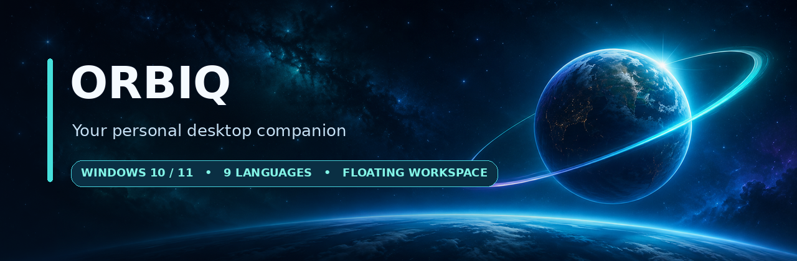

<div align="center">
  

  <h1>Orbiq</h1>
  <p><strong>Your personal desktop companion.</strong></p>
  <p>A customizable floating workspace for everyday tools on Windows.</p>

  <p>
    <a href="https://github.com/Aspydoras/Orbiq/releases/tag/v3.3.2"></a>
    
    
    
  </p>

  <p>
    <a href="https://github.com/Aspydoras/Orbiq/releases/tag/v3.3.2"><strong>Download Orbiq</strong></a>
    · <a href="README_RU.md">Русская версия</a>
    · <a href="https://github.com/Aspydoras/Orbiq/issues">Report an issue</a>
  </p>
</div>

---

## What is Orbiq?

Orbiq is a Windows desktop companion built with **C# and WPF**. It stays close at hand as a small floating circular launcher, expands into a compact workspace, and can be hidden in the Windows notification area.

The goal is simple: keep everyday utilities together without turning the desktop into another large application window.

## Features

| Tool | What it does |
|---|---|
| **Clock** | Stopwatch with lap times and a countdown timer with circular progress. |
| **Notes** | Organize notes into sections, search, pin, color-code, and export to TXT or Markdown. |
| **Calculator** | Mouse and keyboard input, scientific functions, memory keys, and calculation history. |
| **Unit converter** | Convert physical measurements and view reference currency rates. Currency data requires an internet connection and includes its publication date. |
| **Reminders** | Set daily reminders, selected weekdays, or a one-time reminder with sound and snooze options. |
| **Pomodoro** | Configure work sessions, short breaks, long breaks, and the number of sessions before a long break. |
| **Calendar** | Add dated events with a time and description; Orbiq notifies you at the scheduled time. |
| **System monitor** | View CPU usage, RAM usage, battery status, and free space on the system drive. |

### Make it yours

- **Floating launcher:** open sections from the circular desktop icon. Right-click it for quick actions, tray controls, and exit.
- **Appearance:** choose dark, black, light, blue, or a custom color palette.
- **Custom icon:** use an image or animated GIF, then adjust its crop, zoom, and position inside the circle.
- **Reminder sounds:** choose a built-in sound, turn sound off, or use a custom WAV, MP3, or WMA file. Volume is adjustable.
- **Nine interface languages:** English, Russian, Spanish, Portuguese, German, French, Simplified Chinese, Japanese, and Korean. Translations are stored locally and work offline.
- **Global shortcuts:** assign keyboard combinations to actions. Duplicate combinations are rejected; global shortcuts require a modifier key (Ctrl, Alt, Shift, or Win).
- **Backups:** create ZIP backups manually, restore from an archive, or enable optional automatic backups.

## Download

**Current public build: Orbiq v3.3.2 · Windows x64**

1. Open the [Orbiq v3.3.2 release page](https://github.com/Aspydoras/Orbiq/releases/tag/v3.3.2).
2. Download `Orbiq-v3.3.2-win-x64.zip` from the release assets.
3. Extract the ZIP to a folder of your choice.
4. Run `Orbiq.exe`.

The release is a **self-contained Windows x64 build**. You do not need to install .NET separately to run it. Windows may show a SmartScreen notice for an app that is not widely downloaded or digitally signed; only use release files from a source you trust, and do not disable Windows security features to run unknown files.

## Build from source

### Requirements

- Windows 10 or Windows 11 (x64)
- [.NET 10 SDK](https://dotnet.microsoft.com/en-us/download/dotnet/10.0)
- [Visual Studio Code](https://code.visualstudio.com/) (or another editor)
- Optional: C# Dev Kit extension for VS Code

### Run in development

Open the folder containing `Orbiq.csproj` in your editor, then run:

```powershell
dotnet restore
dotnet run
```

### Publish a standalone EXE

In PowerShell, from the project folder:

```powershell
.\publish-win-x64.ps1
```

The script publishes a self-contained `win-x64` build and creates the application output under `publish\win-x64` plus a ZIP archive under `artifacts`.

If PowerShell blocks the local script because of the current execution policy, you can allow scripts for the **current terminal process only** and run it again:

```powershell
Set-ExecutionPolicy -Scope Process -ExecutionPolicy Bypass -Force
.\publish-win-x64.ps1
```

This does not change the machine-wide execution policy. Review scripts before running them.

## Data, backups, and compatibility

Orbiq stores application data locally. To preserve data from earlier MiniHub versions, the application intentionally continues to use the legacy data locations when they already exist:

- `%LOCALAPPDATA%\MiniHub`
- `%LOCALAPPDATA%\MiniHubApp\storage.json`

This is a compatibility detail only; the visible application name and branding are Orbiq. User notes, reminders, calendar events, settings, imported sounds, and images are not part of the source repository. Use Orbiq's backup feature before moving data or reinstalling the application.

## Notes and current limitations

- **One-time reminders:** choose a time only. If that time is still ahead today, the reminder is scheduled for today. If it has passed (or is the current minute), it is scheduled for tomorrow. It disables itself after firing once. Orbiq must remain running, either normally, minimized, or in the notification area.
- **Pomodoro:** continues while Orbiq is minimized to the circle or notification area. An active interval is not restored after a full application exit.
- **CPU temperature:** is not currently displayed because access to temperature sensors depends on the device and its drivers.
- **Currency rates:** require an internet connection and are reference rates, not a guaranteed bank transaction rate.
- **Platform:** the provided standalone release targets Windows x64.

## Contributing and feedback

Bug reports, feature ideas, and feedback are welcome. Please open an [issue](https://github.com/Aspydoras/Orbiq/issues) and include your Orbiq version, Windows version, and steps to reproduce the problem. Do not attach private notes, backups, personal images, or other sensitive data.

## AI-Assisted Development

Orbiq was developed with the assistance of artificial intelligence tools.

AI assistance was used for:
- Writing and refining parts of the source code.
- Debugging and troubleshooting.
- Improving the user interface and application architecture.
- Localization and multilingual support.
- Documentation and project presentation.

**The project concept, feature requirements, design direction, testing, feedback, and release decisions are led by the project maintainer.**

Orbiq is an independent project developed through human–AI collaboration.

## License

A license has not yet been selected for this repository. Until a license is added, please do not assume that the source code may be reused, modified, or redistributed.

---

<div align="center">
  <sub>Orbiq · A little orbit of useful tools on your desktop.</sub>
</div>
