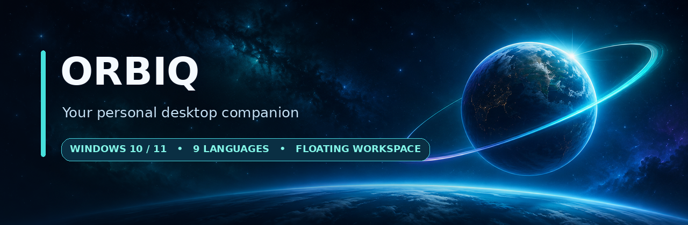

<div align="center">
  

  <h1>Orbiq</h1>
  <p><strong>Твой персональный помощник на рабочем столе.</strong></p>
  <p>Настраиваемая плавающая панель с повседневными инструментами для Windows.</p>

  <p>
    <a href="https://github.com/Aspydoras/Orbiq/releases/tag/v3.3.2"></a>
    
    
    
  </p>

  <p>
    <a href="https://github.com/Aspydoras/Orbiq/releases/tag/v3.3.2"><strong>Скачать Orbiq</strong></a>
    · <a href="README.md">English version</a>
    · <a href="https://github.com/Aspydoras/Orbiq/issues">Сообщить об ошибке</a>
  </p>
</div>

---

## Что такое Orbiq?

Orbiq — приложение-помощник для Windows, созданное на **C# и WPF**. Оно находится под рукой в виде небольшого плавающего круглого значка, раскрывается в компактную панель и может скрываться в области уведомлений Windows.

Идея проста: собрать повседневные инструменты в одном месте, не превращая рабочий стол в ещё одно большое окно.

## Возможности

| Инструмент | Что умеет |
|---|---|
| **Часы** | Секундомер с отсечками и обратный таймер с круговой индикацией. |
| **Заметки** | Разделы, поиск, закрепление, цветовые метки и экспорт в TXT или Markdown. |
| **Калькулятор** | Ввод мышью и клавиатурой, научные функции, память и история вычислений. |
| **Конвертер** | Физические величины и справочные валютные курсы. Для валют нужен интернет; отображается дата курса. |
| **Напоминания** | Ежедневные напоминания, выбранные дни недели или один раз; звук и отсрочка. |
| **Pomodoro** | Настройка рабочего интервала, короткого и длинного перерыва, а также числа сессий до длинного перерыва. |
| **Календарь** | События с датой, временем и описанием; уведомление в назначенное время. |
| **Мониторинг** | Загрузка CPU, использование RAM, состояние батареи и свободное место системного диска. |

### Настрой Orbiq под себя

- **Плавающая панель:** открывай разделы через круглый значок. Правая кнопка мыши открывает быстрые действия, управление треем и выход.
- **Внешний вид:** чёрная, тёмная, светлая, голубая тема или собственная палитра.
- **Своя иконка:** изображение или анимированный GIF с настройкой кадрирования, масштаба и положения внутри круга.
- **Звуки напоминаний:** встроенные сигналы, отключение звука или собственный WAV, MP3 либо WMA. Громкость регулируется отдельно.
- **Девять языков интерфейса:** английский, русский, испанский, португальский, немецкий, французский, упрощённый китайский, японский и корейский. Переводы хранятся локально и работают без интернета.
- **Глобальные горячие клавиши:** сочетания для отдельных действий. Дубликаты запрещены; для глобальной комбинации нужна клавиша Ctrl, Alt, Shift или Win.
- **Резервные копии:** ручное создание ZIP, восстановление из архива и необязательное автоматическое резервирование.

## Скачать

**Текущая публичная сборка: Orbiq v3.3.2 · Windows x64**

1. Открой [страницу релиза Orbiq v3.3.2](https://github.com/Aspydoras/Orbiq/releases/tag/v3.3.2).
2. Скачай `Orbiq-v3.3.2-win-x64.zip` из списка файлов релиза.
3. Распакуй ZIP в выбранную папку.
4. Запусти `Orbiq.exe`.

Это **автономная сборка для Windows x64**: отдельно устанавливать .NET для запуска не нужно. Windows может показать предупреждение SmartScreen для приложения, которое ещё мало скачивали или которое не имеет цифровой подписи. Используй файлы только из доверенного источника и не отключай защиту Windows ради запуска неизвестных файлов.

## Сборка из исходников

### Требования

- Windows 10 или Windows 11 (x64)
- [.NET 10 SDK](https://dotnet.microsoft.com/en-us/download/dotnet/10.0)
- [Visual Studio Code](https://code.visualstudio.com/) или другой редактор
- Дополнительно: расширение C# Dev Kit для VS Code

### Запуск для разработки

Открой в редакторе папку, в которой находится `Orbiq.csproj`, затем выполни:

```powershell
dotnet restore
dotnet run
```

### Публикация автономного EXE

В PowerShell из папки проекта:

```powershell
.\publish-win-x64.ps1
```

Скрипт создаёт автономную сборку `win-x64` в `publish\win-x64`, а ZIP-архив — в `artifacts`.

Если PowerShell блокирует локальный скрипт из-за текущей политики выполнения, можно разрешить запуск только для текущего процесса терминала и повторить команду:

```powershell
Set-ExecutionPolicy -Scope Process -ExecutionPolicy Bypass -Force
.\publish-win-x64.ps1
```

Это не меняет системную политику выполнения. Перед запуском сценариев проверяй их содержимое.

## Данные, резервные копии и совместимость

Orbiq хранит данные локально. Для сохранения данных из прежних версий MiniHub приложение намеренно продолжает использовать старые расположения, если они уже существуют:

- `%LOCALAPPDATA%\MiniHub`
- `%LOCALAPPDATA%\MiniHubApp\storage.json`

Это сделано только для совместимости: в интерфейсе, названии сборки и оформлении используется Orbiq. Личные заметки, напоминания, события календаря, настройки, импортированные звуки и изображения не входят в исходный репозиторий. Перед переносом данных или переустановкой используй функцию резервного копирования Orbiq.

## Особенности и текущие ограничения

- **Напоминание без повтора:** указывается только время. Если оно ещё впереди сегодня, напоминание сработает сегодня. Если время уже прошло или совпадает с текущей минутой, оно переносится на завтра. После одного срабатывания отключается. Orbiq должен оставаться запущенным — обычно, свёрнутым в круг или в области уведомлений.
- **Pomodoro:** продолжает работать при сворачивании в круг или трей. Текущий интервал не восстанавливается после полного выхода из приложения.
- **Температура CPU:** пока не отображается, поскольку доступ к датчикам зависит от устройства и драйверов.
- **Валютные курсы:** требуют интернет и являются справочными, а не гарантированным курсом банковской операции.
- **Платформа:** готовая автономная сборка предназначена для Windows x64.

## Обратная связь и сообщения об ошибках

Идеи, сообщения об ошибках и отзывы приветствуются. Создай [issue](https://github.com/Aspydoras/Orbiq/issues) и укажи версию Orbiq, версию Windows и шаги для воспроизведения проблемы. Не прикладывай личные заметки, резервные копии, фотографии и другие конфиденциальные данные.

## Лицензия

Лицензия для репозитория пока не выбрана. Пока файл лицензии не добавлен, не следует считать, что исходный код разрешено повторно использовать, изменять или распространять.

---

<div align="center">
  <sub>Orbiq · Маленькая орбита полезных инструментов на рабочем столе.</sub>
</div>
